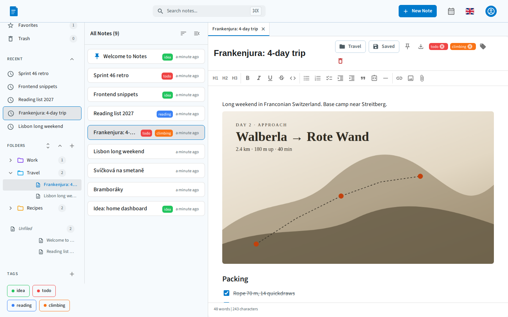
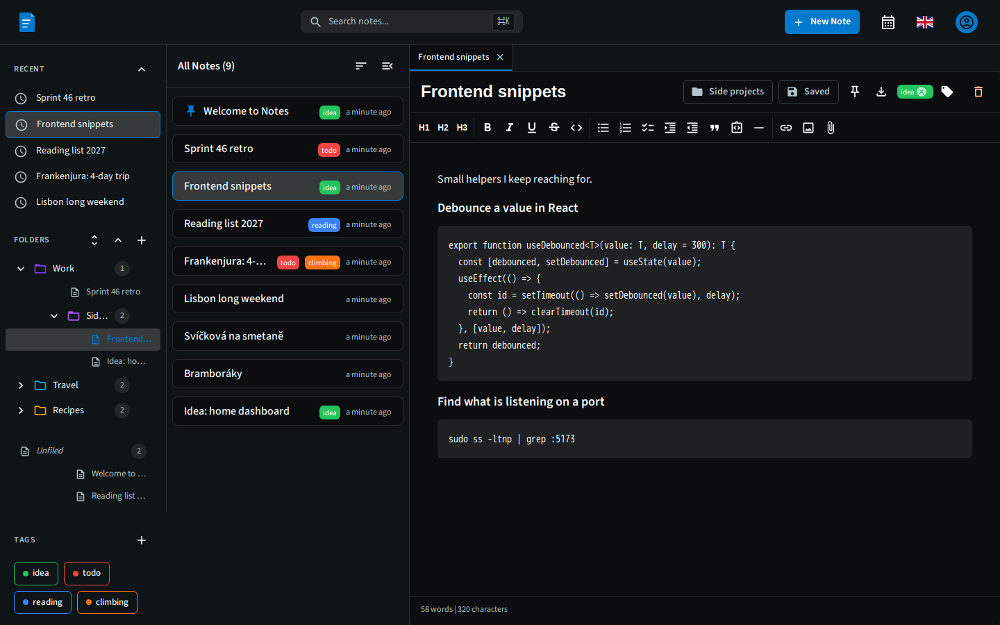
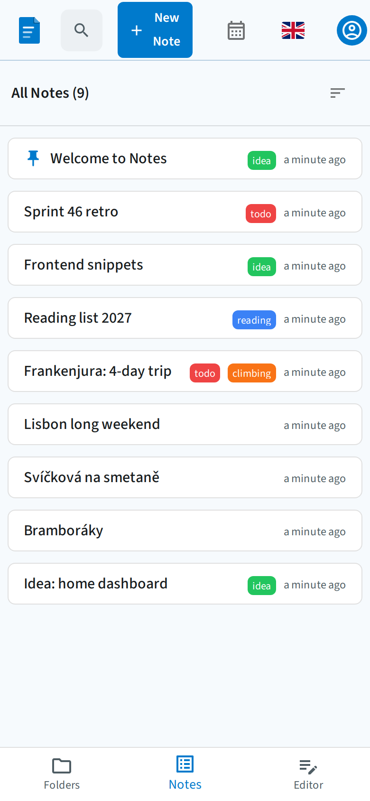
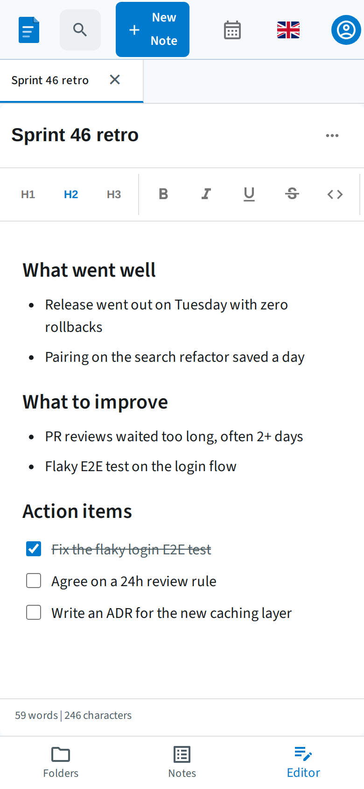

# notes.nettio.eu

A server-backed, single-owner notes app. React + Vite frontend, .NET 10 API, PostgreSQL 16, Keycloak 26 auth, packaged as a PWA.

Live at **https://notes.nettio.eu**. A pet project I build and run end to end, from the editor UI to the server it deploys to.



<table>
  <tr>
    <td width="50%"></td>
    <td width="25%"></td>
    <td width="25%"></td>
  </tr>
</table>

A demo login with sample content is available on request.

## What it is

- **Single-tenant per user** — every entity has a `UserId`; ownership enforced server-side.
- **Rich text editing** via TipTap.
- **Folder + tag organization** with full-text search.
- **Installable PWA** with ~1h offline read cache. Not offline-first — see [ADR 0005](./docs/adr/0005-no-offline-first-sync.md).
- **OIDC auth** via self-hosted Keycloak (PKCE, JWT bearer).

## In production

- Runs on a single VPS under `nettio.eu`, next to other projects on their own subdomains.
- The edge proxy (Nginx, Let's Encrypt) and the shared login (Keycloak, realm `nettio` at `auth.nettio.eu`) live in a separate platform repo. This app only joins its Docker network, so deploying Notes never restarts anything else.
- Merging to `main` deploys: GitHub Actions builds the images, pushes them to GHCR and calls a restricted deploy hook. That key can only deploy the current head of `main`, never open a shell.
- Every image and GitHub Action is pinned by digest or commit SHA.
- Nightly database dumps, daily disk images, and an uptime check that alerts on Telegram.

## Quick start

```bash
# Bring up the full stack (Postgres + Keycloak + API + frontend)
docker compose up -d

# Or run the frontend on Vite for hot reload, with everything else in Docker
cd ui && npm install && npm run dev
```

| What | Where |
|---|---|
| Frontend (Vite) | http://localhost:5173 |
| Frontend (Docker) | http://localhost:3000 |
| API | http://localhost:5001 |
| API OpenAPI | http://localhost:5001/openapi/v1.json *(dev only)* |
| Keycloak | http://localhost:8080 (admin / admin) |
| Postgres | localhost:5432 (postgres / postgres) |

Test user: `testuser / testuser`.

## Tech stack

| Layer | Tech |
|---|---|
| Frontend | React 19, TypeScript, Vite 7, MUI v6, Redux Toolkit, TipTap |
| Backend | .NET 10, ASP.NET Core, EF Core, Npgsql |
| Database | PostgreSQL 16 (locally it also hosts Keycloak's DB; in production Keycloak has its own) |
| Auth | Keycloak 26 (OIDC/JWT), the shared nettio login in production |
| Edge | Nginx 1.27 + Let's Encrypt, in the platform repo |
| CI/CD | GitHub Actions → GHCR → restricted deploy hook |

## Repository layout

```text
notes/
├── api/              .NET API project + integration tests
├── ui/               React frontend (also contains its own docs/)
├── docs/             ← Documentation lives here
├── scripts/          One-off ops scripts
├── docker-compose.yml          Local dev stack
├── docker-compose.prod.yml     Production stack
├── init-db.sql                 Creates `notes` + `keycloak` databases
├── notes-{dev,prod}-realm.json Keycloak realm exports
├── README.md         ← you are here
├── CLAUDE.md         Orientation for AI assistants (auto-loaded by Claude Code)
├── AGENTS.md         Pointer to CLAUDE.md for tools using the AGENTS.md convention
└── CONTRIBUTING.md   Branches, commits, PRs, code style
```

## Documentation

The doc set lives in [`docs/`](./docs/README.md). Highlights:

- **[Architecture](./docs/architecture.md)** — system overview, request flow, components
- **[Data model](./docs/data-model.md)** — entities, relationships, schema
- **[Auth](./docs/auth.md)** — Keycloak realm, OIDC flow, JWT validation
- **[API](./docs/api.md)** — endpoint catalog, conventions
- **[Deployment](./docs/deployment.md)** — CI/CD pipeline, deploy runbook
- **[Operations](./docs/operations.md)** — logs, backup, restore, troubleshooting
- **[Security](./docs/security.md)** — threat model, secrets, ownership
- **[PWA](./docs/pwa.md)** — service worker, update prompt, offline behavior
- **[Testing](./docs/testing.md)** — vitest + playwright, coverage thresholds
- **[Error handling](./docs/error-handling.md)** — ProblemDetails end-to-end
- **[ADRs](./docs/adr/)** — architecture decisions and their rationale

Frontend-specific deep dives in [`ui/docs/`](./ui/docs/) — [editor architecture](./ui/docs/editor-architecture.md), [styling](./ui/docs/styling-guide.md), [theming](./ui/docs/theming.md), [i18n](./ui/docs/i18n.md), [performance](./ui/docs/performance.md).

## Common commands

```bash
# Local dev stack
docker compose up -d
docker compose down

# Frontend
cd ui
npm install
npm run dev           # vite at :5173
npm run build         # production build
npm run lint          # tsc + eslint
npm run test:run      # unit tests once
npx playwright test   # E2E (needs full stack running)

# Backend
cd api
dotnet build
dotnet run --project EpoznamkyApi   # API at :5001
dotnet test                          # integration tests

# DB migrations
cd api/EpoznamkyApi
dotnet ef migrations add <Name>
dotnet ef database update           # dev only; prod is manual
```

## How it's built

Developed with AI coding assistants (Claude Code; see [`CLAUDE.md`](./CLAUDE.md)). The design choices and their trade-offs are written down as [ADRs](./docs/adr/), for example why there is [no offline-first sync](./docs/adr/0005-no-offline-first-sync.md) and why notes use [optimistic concurrency](./docs/adr/0009-optimistic-concurrency-on-note-put.md).

## Contributing

See [`CONTRIBUTING.md`](./CONTRIBUTING.md). TL;DR: branch from `main`, atomic commits, PR with test plan, pre-commit hook runs `lint + build`.

## License

[MIT](./LICENSE) © 2025-2026 Marek Melichar.
